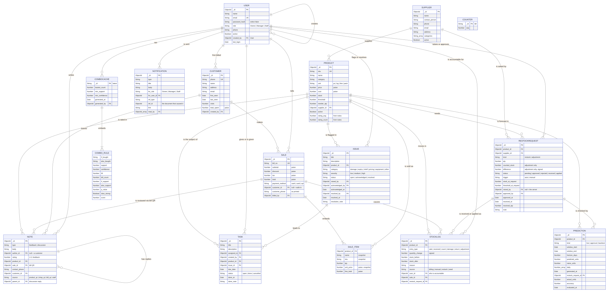

# Smart Inventory Assistant — Project Document

*Mini Project III · Asigha K G & Nirupa K V · revised 19 Oct 2026, after Phase 3*

This document describes the system **as built**. It replaces the build plan of 24 Sep 2026, which is
kept in git history (`git show cd9a7dd:docs/PLAN.md`). Where the plan promised something that was not
built, section 9 says so.

| Document | What it is |
|---|---|
| `docs/PLAN.md` | This document: what SIA is, how it is designed, and why |
| `docs/SCHEMA.md` | Every collection, field, rule and index, **generated from the code** |
| `docs/diagrams/` | ER, schema, architecture and system-flow diagrams (`.mmd` source, `.svg`, `.png`) |
| `docs/ML-BUILD-LOG.md` | How the ML features were built and measured, step by step |
| `docs/STUDY-GUIDE.md`, `docs/REVIEW-SCRIPT.md` | Revision notes and the review speech |

---

## 1. Project statement

> A centralised inventory system for a small supermarket. Stock, suppliers and thresholds live in one
> place; restock requests raise themselves the moment stock crosses a threshold; sales are recorded at
> the till against an optional phone number; customers leave feedback by scanning a QR with no
> account; floor problems, tasks and handovers are tracked in the same system; and an
> association-rule model pairs slow-moving products with strong sellers, explains each pairing in
> support, confidence and lift, then checks its own predictions against what actually sold.

It replaces a notebook and a phone: nobody could say what sold last month, what keeps running out,
or who changed a stock count.

## 2. Roles

| Role | Does |
|---|---|
| **Owner** | Creates the Manager. Sees everything: stock, sales, analytics, feedback, issues, tasks. **Runs nothing and bills nothing**: the account that reviews the takings cannot create them. |
| **Manager** | Products, thresholds, suppliers. Approves restock orders and out-of-tolerance stock counts; marks deliveries received. Hires Staff. Edits customer records. Acknowledges and resolves issues; hands out tasks. Runs the combo and forecast analyses. **Bills too.** |
| **Staff** | The floor and the till: bills sales, captures customers while billing, counts stock, receives deliveries, flags issues, finishes tasks, posts in Discussion. |
| **Customer** | **Not a role.** A phone-keyed record with no login and no password. |

Accounts are created down a chain, Owner → Manager → Staff; nobody self-registers, so the seed creates
the first Owner. Every rule below is enforced **on the server, on every request**. The screens only
hide what the server would refuse anyway.

| Action | Owner | Manager | Staff |
|---|:-:|:-:|:-:|
| Bill a sale | — | ✓ | ✓ |
| Create / edit products and suppliers | — | ✓ | — |
| Record a stock count; small write-offs within tolerance | — | ✓ | ✓ |
| Write off or correct beyond tolerance directly | — | ✓ | — (must count; Manager approves) |
| Approve / reject restock orders and stock counts | — | ✓ | — |
| Mark a delivery received | — | ✓ | ✓ |
| Edit a customer record | — | ✓ | — |
| Flag an issue | — | ✓ | ✓ |
| Acknowledge / resolve / reopen an issue | — | ✓ | — |
| Give, send back or cancel a task | — | ✓ | — |
| Finish a task | — | ✓ | the person it was given to |
| Post in Discussion | ✓ | ✓ | ✓ |
| Create accounts | Managers and Staff | Staff only | — |
| Combos, forecast, product performance | ✓ | ✓ | — |
| Print shelf and shop QR codes | ✓ | ✓ | bill QR only |

**Shrinkage control without a fourth role.** Splitting till from stock normally guards against someone
pocketing a sale and "correcting" the count later. Here every `StockLog` row and every `Sale` names the
person responsible, and the control lives in the workflow instead: a count that differs from system
stock **by more than 5% or 3 units, whichever is larger,** does not change stock. It waits for the
Manager (section 5.2).

## 3. Architecture


Three tiers, plus an optional ML service:

| Tier | Technology | Port |
|---|---|---|
| Presentation | React 19 + Vite, React Router, Bootstrap 5, Recharts, Bootstrap Icons (bundled, no CDN) | 5173 |
| Application | Node.js, Express 4, JWT (`jsonwebtoken`), bcrypt, `express-rate-limit`, `qrcode` | 5000 |
| Data | MongoDB 8 (local Windows service), Mongoose 8, database `sia` | 27017 |
| ML (optional) | Python, FastAPI, pandas, mlxtend (Apriori), scipy (Fisher's exact test), scikit-learn (LinearRegression) | 8000 |

- **Express is the only process that touches MongoDB.** FastAPI receives bills in the request body and
  returns rules and forecasts; it holds no credentials. Results are saved in `combocaches` and
  `predictions`, so the combo and forecast screens still work with Python switched off.
- **The sidebar and the router are generated from one role-filtered list**
  (`client/src/config/navigation.jsx`). A screen cannot be in the menu without a component behind it,
  and a role cannot reach a URL its menu does not show.
- **No internet is needed at the demo.** Fonts are system fonts and icons are bundled. The API host is
  derived from the page's own address, so a phone on the same Wi-Fi that scans a QR code reaches the
  laptop.

## 4. The database



**11 domain collections, plus 3 supporting ones.** The full field list, rules and indexes are in
[`docs/SCHEMA.md`](SCHEMA.md), generated from `server/models/`. The class view of the same schema is
[`diagrams/schema.svg`](diagrams/schema.svg).

| Collection | Holds | Since |
|---|---|---|
| `users` | Staff accounts: Owner, Manager, Staff. Never deleted, only deactivated | Phase 1 |
| `suppliers` | Who supplies which categories | Phase 1 |
| `products` | Catalogue, price, stock, threshold, reorder quantity, denormalised rating | Phase 1 |
| `stocklogs` | **Append-only ledger.** Every movement, with before, change, after and who | Phase 1 |
| `restockrequests` | Reorders raised by the server, **and** stock counts waiting for approval (`kind`) | Phase 1, `kind` in Phase 3 |
| `sales` | Bills, with line items **embedded** and frozen at the moment of sale | Phase 1 |
| `customers` | Phone-keyed records, no password field | Phase 1 |
| `notes` | Customer feedback (no author) and staff discussion (an author, optional parent) | Phase 1 |
| `notifications` | Written by the event that caused them; aimed at a role or a person | Phase 1 |
| `issues` | Floor problems: open → acknowledged → resolved | Phase 1 schema, Phase 3 screen |
| `tasks` | Work the Manager gives a named person, with a due date | Phase 3 |
| `combocaches` | The last combo analysis, so the screen survives Python being off | Phase 2 |
| `predictions` | Forecasts, later filled in with what actually sold | Phase 2 |
| `counters` | Atomic bill-number sequence | Phase 1 |

### Design rules used throughout

- **Embed or reference.** `Sale.items[]` is embedded: a bill is read as one unit and must freeze when
  it is printed. Everything else is referenced by `ObjectId`, because products, customers and users
  change independently.
- **Three deliberate denormalisations,** each for a reason: `Sale.items[].name/sku/unit_price` and
  `Sale.customer_phone` (a reprint shows what the customer was handed), and
  `Product.rating_avg/rating_count` (the product list sorts by rating without aggregating notes).
- **Money is integer paise,** never floating point, and is converted to rupees only at the API edge.
  Aggregations work in paise and convert once at the end.
- **Nothing is hard-deleted.** Users, products and suppliers are deactivated. MongoDB enforces no
  foreign keys, so soft deletion is what keeps old bills and ledger rows pointing at something real.
  Tasks are cancelled, not deleted. Deactivating a product closes its open requests.
- **Constraints the database enforces:** unique `email`, `sku`, `phone`, `bill_no`; and **one open
  request per product and kind** (a partial unique index on `restockrequests`), so two tills selling
  the last unit at the same moment cannot raise two reorders.
- **Derived values are maintained by the code that owns them.** A `pre('validate')` hook computes bill
  totals from the lines. Ratings are recomputed from feedback. Low-stock status is a virtual, never
  stored.
- **`password_hash` is `select: false`** and is stripped in `toJSON`, so it cannot leak through a
  careless response.
- **Bill numbers come from an atomic counter** (`findOneAndUpdate` with `$inc`), not from a count or
  a timestamp.

**Why 11 and not 10.** The plan fixed 10 domain collections. Phase 3 added `tasks`, because a task is
not the same shape as anything already there. An issue is a *report* from whoever spots a problem; a
task is an *instruction* to a named person with a due date. Forcing tasks into `issues` would have
left half the fields empty on every document. The count was never the goal; one shape per collection
was.

## 5. How the main features work

### 5.1 Auto-restock: the headline behaviour


Every path that moves stock goes through one function, `adjustStock()` in
`server/services/stockService.js`. That covers a sale, a delivery, a count, a write-off and an
approved adjustment, and **the threshold check lives inside it**, so it fires at runtime and never
only in demo data.

1. Stock changes with an atomic `$inc` whose filter refuses to go below zero, so two tills cannot
   oversell the last unit.
2. A ledger row records before, change, after, the reason and the person.
3. If stock went down and is now at or below the threshold, a `RestockRequest` is created with
   `raised_by: null` (the server, not a person) and the Manager is notified.
4. If an open request already exists, the partial unique index rejects the insert. That outcome is
   expected, and it is how duplicates are prevented.
5. The Manager approves (and a forecast is recorded so the decision can be checked later), then a
   delivery is marked received. Stock rises through the same function, and the request closes.

The rule itself, `shouldRestock()`, is one pure function in `stockRules.js` used by both the live
service and the seed's replay, so the two cannot drift apart.

### 5.2 Stock counts and adjustments (Phase 3)

A physical count within tolerance applies at once as a `count` ledger row. Beyond tolerance it becomes
a `RestockRequest` with `kind: 'adjustment'`, the `counted_stock` and the signed `difference`, and
**stock does not change.** The Manager sees it under *Stock counts awaiting approval* on the Restock
screen:

- **Apply** writes the difference through `adjustStock()` as an `adjustment` ledger row, in the name
  of the person who counted, citing the approver. The request closes as `applied`.
  The *difference* is applied rather than the counted figure, because sales made since the count moved
  both the shelf and the system by the same amount.
- If stock has fallen too far since the count for the correction to fit, approval is **refused with a
  reason**, not clamped. The Manager rejects it and someone counts again.
- **Reject** leaves stock alone. Either way, the person who counted is notified.

A Staff member cannot get round this by writing stock off directly: `/api/stock/adjust` holds Staff to
the same tolerance.

*Fixed in Phase 3:* before this, an adjustment was stored as a plain restock request. Approving it left
it "in transit", **Mark received then added the difference as a delivery** (a shortage of 10 became 10
extra), and a pending count blocked the automatic reorder for that product. `npm run migrate` upgrades
a database created before the fix.

### 5.3 Billing: one component, two entry points

The till and a customer's record open the same billing screen. The phone field drives it: **blank** is
a walk-in and nothing is ever gated on a number; a **new number** opens an inline form and the customer
is created as part of the sale; a **known number** loads the customer, who can be corrected inline.
`visits`, `last_seen` and `total_spent` are updated from the sale itself. The bill stores both
`customer_id` (so history survives a phone change) and `customer_phone` (what was printed).

### 5.4 QR feedback: no login, ever


| QR | Lives on | Opens | Effect |
|---|---|---|---|
| Product | shelf label | `/feedback/:productId` | that product pre-selected |
| Shop | counter / door | `/feedback` | pick a product, then rate |
| Bill | printed receipt | `/feedback?sale=:saleId` | the items just bought, pre-filled |

A public route with no auth, no redirect and no account prompt. Feedback is a `Note` with
`author_id: null`; a phone that matches a customer links it to their history. A rating of 2 or less
notifies the Manager. Public writes are **rate-limited per IP**, because the bad-review notification
would otherwise be trivially spammable.

### 5.5 The floor: issues, tasks and discussion (Phase 3)

- **Issues.** Anyone on the floor flags a problem with a category, severity and optional product. The
  Manager is notified, acknowledges it, and resolves it with a note, or reopens it if the "fixed"
  chiller is warm again. Each step records who and when, and the person who flagged it is told. Open
  issues are listed most urgent first. **Make a task** on an issue opens a pre-filled task form.
- **Tasks.** The Manager gives a named Staff member or Manager a task, with an optional due date,
  product and source issue. The assignee marks it done with a note; the Manager can send it back or
  cancel it. Overdue and due-today tasks are marked. Staff see their own tasks; the Manager and Owner
  see everyone's.
- **Discussion.** An internal noticeboard of posts with one level of replies. A reply to a reply joins
  the original post, so threads stay readable on a phone. The original poster is notified of replies.
  Posts are `Note` documents with `type: 'discussion'`, kept apart from customer feedback in every
  query.

### 5.6 Notifications (Phase 3 centre)

Notifications are **only ever written by the event that caused them.** Each points back at that
document (`ref_type`, `ref_id`) and at the screen to open (`link`), and is addressed to a role or to
one person. The bell shows the **true** unread count and the latest twelve. The Notifications screen
has the full history, a page at a time (paged by date plus id, so nothing falls between pages),
filtered by group and by unread. A person can only mark as read what was addressed to them.

### 5.7 Combos, forecast and product performance (Phase 2)

Covered step by step, with every measurement, in `docs/ML-BUILD-LOG.md`. In short:

- **Combos:** Apriori over every bill (minimum support 0.003, minimum confidence 0.2). A rule is kept
  only if **Fisher's exact test gives p < 0.01**. Tested by mining the first 70% of bills and checking
  the last 30%: 96.8% of kept rules still showed the pair together more often than chance (lift above
  1), against 72.1% of the rules the test rejected, with predicted confidence off by about 5 points.
  That measures the method on unseen bills; the bill dates are generated, so it says nothing about
  seasons. Ranked to favour a slow seller paired with a strong one.
- **Forecast:** a weekday shape learned with LinearRegression from whole-shop sales, scaled to each
  product's average. On three hidden backtest weeks, weekly accuracy per product is **81.6%**, against
  80.9% for the 4-week average. That edge is **not statistically significant** (p = 0.12), and the
  4-week average won one of the three weeks. Because a week holds each weekday once, the weekly figure
  equals a plain all-history average (also 81.6%). The regression earns its place on the **daily**
  split: 55.5% per product per day, against 51.3% for a flat average. An oracle told each product's
  true average scores 83.1% on the same weeks. Forecasts made at approval are later filled in with
  actual sales by an hourly timer.
- **Performance:** sales combined with QR ratings to separate delisting candidates from pairing
  problems.

## 6. The data

**Source: the Groceries dataset** from the R `arules` package (Hahsler, Grün & Hornik): 9,835 real
point-of-sale baskets of 169 item categories from one month at a European grocery outlet, committed as
`server/seed/data/groceries.csv` (sha256 `ff1be892…23ae3b`). The basket structure is real and is never
changed. Everything the dataset lacks is generated around it: prices, dates, quantities, customers and
stock.

- The 169 items are mapped one-to-one to Indian retail products in
  `server/seed/data/catalogue.json`, and the mapping is semantic (flour → Aashirvaad Atta), so the
  associations still mean what the real data recorded.
- **The seed replays 90 days in order.** Each day's sales go through the same threshold rule as the
  live service, requests are raised when it fires and received 2–4 days later. So the ledger
  reconciles to current stock exactly, and every historical request exists because the rule really
  fired. It is deterministic (fixed random seed), so every run produces the same database.
- **Honest caveats:** the source spans 30 days and is re-dated across 90; the items are aggregated
  European categories mapped to Indian products; about ten are alcohol, kept because *beer + liquor*
  is one of the strongest real associations.
- The floor data (6 issues, 7 tasks, 3 discussion threads, one pending stock count) is hand-written
  demo content, dated relative to the replay so that "due today" and "overdue" are true at the demo.

## 7. How it is verified

Every check runs against the real database or the running API; none of them is mocked.

| Command | Checks | Result (19 Oct 2026) |
|---|---|---|
| `npm run verify` | Database invariants: ledger reconciles, one open request per product and kind, bills add up, no customer password, adjustments reach the ledger, issue and task states consistent, discussion threads well-formed, and more | **20/20**, on the live database and on a fresh seed |
| `npm run apitest` | Phase 1 verification list against the API: roles, auth, auto-restock, no duplicates, receiving, customers, QR feedback, tolerance | **36/36** |
| `npm run ml-demo` | Phase 2 list: combos, a lift hand-checked in MongoDB, ranking, performance, forecast and backtest, bill QR | **13/13** |
| `npm run phase3test` | Phase 3 list plus edge cases: adjustments, issues, tasks, discussion, notification centre | **69/69** |
| `npm run docscheck` | Every field in the ER diagram against the Mongoose schemas, both ways; generated schema docs are current | **20/20** |

The screens were also driven in a real browser (Edge, through Playwright) for each role at desktop and
phone width. That covered flagging an issue, acknowledging it, making a task from it, finishing the
task, resolving the issue, posting and replying, and reading notifications, with no browser errors.

## 8. Running it

```bash
npm run setup          # install server and client packages
npm run seed           # rebuild the sia database (about 20 s)
npm run dev            # API :5000, screens :5173, and the ML service :8000 if ml/venv exists
npm run verify         # database invariants
npm run migrate        # only for a database created before Phase 3
```

Demo logins (printed by the seed): `owner@sia.local / Owner@123`, `manager@sia.local / Manager@123`,
`staff1@sia.local / Staff@123`, `staff2@sia.local / Staff@123`. The ML service setup is in
`ml/README.md`.

## 9. Limitations, and what the plan promised but was not built

- **No `$jsonSchema` validators in MongoDB.** The plan called for validation in two layers. Only the
  Mongoose layer exists, so a document written directly from `mongosh` or Compass is not checked.
- **No multi-document transactions.** MongoDB runs standalone, so a sale (write the bill, move stock,
  maybe raise a request) is not atomic as a whole. Each step is individually safe, and the stock
  update itself is atomic. A single-node replica set would allow transactions.
- **`node-cron` was not used.** One fixed hourly job did not justify a package; a plain timer in
  `server/index.js` fills in forecast actuals.
- **The test scripts run against the live database.** `apitest` and `phase3test` bill sales against
  throwaway products, so today's revenue on the dashboard includes test bills. `phase3test` removes
  its issues, tasks, posts and alerts afterwards. Run `npm run seed` before a demo for clean figures.
- **Notifications are polled** every 15–20 seconds rather than pushed.
- **The weekly forecast is no better than a plain average.** Its 0.7-point lead over the 4-week
  average is not statistically significant, and on weekly totals it equals the all-history average.
  It is 1.5 points below an oracle that knows each product's true average. `ML-BUILD-LOG.md`
  section K has the measurements.

## 10. Build history

| Phase | Dates | Delivered |
|---|---|---|
| 1 | 24–25 Sep 2026 | Database, seed replay, auth and roles, products, stock ledger, auto-restock, billing, customers, suppliers, QR feedback, team, dashboard |
| 2 | 10–15 Oct 2026 | FastAPI service, Apriori combos with significance test, ranking, product performance, forecast with backtesting and approval checks, bill QR, charts |
| 3 | 19 Oct 2026 | Stock adjustments with their own approval flow (and the bug fixes above), issues, tasks, discussion, notification centre, larger type across the app, these documents and diagrams |
